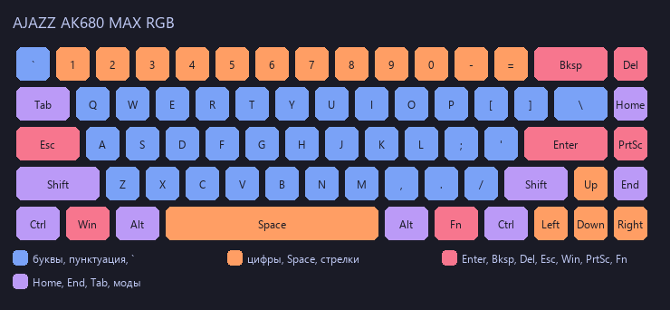

# AK680 MAX Layout

Кастомная раскладка для **AJAZZ AK680 MAX RGB** (wired USB, Hall-effect, VID/PID
`3151:502D`, Device ID `2255`, протокол RY5088) под Arch Linux / Hyprland.

## Что настроено

| Клавиша | Стало | Где реализовано |
|---------|-------|-----------------|
| CapsLock | **Esc** (CapsLock убран за ненадобностью) | прошивка (remap index 3 → Escape) |
| Esc (угол, слева от 1) | **`** (HID grave; в RU — ё) | прошивка (remap index 1 → grave) |
| Fn + «е» (физический `T`) | **`** (в RU — ё) — запасной способ | прошивка (remap `Fn+T` → `` ` ``) |
| Колонка (Home/Del/PgUp/PgDn) | **Del/Home/PrtSc/End** (PrtSc и End вернули как было) | прошивка (remap 85–88) |
| Правый Shift | **обычный Shift** (по умолчанию) | — |
| Правый Alt | **переключение на EN** | Hyprland bind `code:108` |
| Правый Ctrl | **переключение на RU** | Hyprland bind `code:105` |
| Подсветка | TokyoNight по клавишам | userpic в слот 0, режим LED 13 |

> CapsLock не нужен: физический Caps теперь **Esc**. Штатное место Esc (угол) отдано
> под **`` ` ``** (grave; в EN это `` ` ``/`~`, в русской раскладке — ё). Если `` ` ``
> понадобится ещё где-то — работает `Fn+«е»` (физический `T`): в EN даёт `` ` ``,
> в RU — «ё».

> Ремапы прошивки — по **индексам матрицы**, не по именам: `iot_driver` берёт имена
> клавиш из статической таблицы, которая для этой клавиатуры расходится с физикой
> (86→Delete, 87→PageUp, 88→PageDown). Подробности — в
> [docs/issue-monsgeek-akko-linux.txt](docs/issue-monsgeek-akko-linux.txt).

## Восстановление после сброса

`iot_driver reset` (или сброс зажатием клавиш при включении) стирает ремапы, Hall Effect
и подсветку. Всё возвращается **одной командой** с Windows-машины — клавиатура по USB,
права администратора не нужны:

```powershell
python windows\ak680_apply.py --yes      # ремапы + Hall Effect + подсветка
python windows\ak680_apply.py --verify   # когда угодно: сверить с целевым состоянием
```

Что именно заливается (источник истины — `windows/ak680_apply.py`):

| Что | Значение |
|-----|----------|
| base-слой | `3→Esc`, `1→grave`, `85→Del`, `86→Home`, `87→PrtScr`, `88→End` |
| Fn-слой | `Fn+T` → grave (в EN — `` ` ``, в RU — ё) |
| Hall Effect | активация 1.0 мм, отпускание 1.5 мм, все 90 позиций |
| Подсветка | userpic TokyoNight по клавишам, слот 0, режим LED 13 |

Скрипт сам снимает бэкап в `backup-<ts>.json`, пишет с проверкой (запись → чтение назад →
повтор) и в конце печатает контрольное чтение. Эквивалент без Windows (но без подсветки) —
команды `iot_driver` ниже. Подсветку на Linux можно залить готовым PNG из `assets/`.

## Файлы

| Файл в репо | Куда | Зачем |
|-------------|------|-------|
| `bin/layout-switch.sh` | `~/bin/layout-switch.sh` | переключение раскладки **всех** клавиатур Hyprland (`0`=EN, `1`=RU) |
| `xkb/symbols_custom_xkb` | _архив_ (было `/usr/share/X11/xkb/symbols/custom`) | вариант `rshift_compose` — если захочешь вернуть Compose на другую клавишу |
| `hypr/keyboard.lua` | фрагмент для `~/.config/hypr/hyprland.lua` | `kb_layout = "us,ru"` + бинды `code:108/105` + старт Deskflow (**фрагмент**, не конфиг целиком) |
| `docs/keymap-raw.txt` | — | полная физическая карта клавиш (wev) |
| `docs/issue-monsgeek-akko-linux.txt` | — | баг-репорт для monsgeek-akko-linux |
| `windows/ak680_apply.py` | — (запускать с Windows-машины) | заливка firmware-конфига **с Windows** через HID (hidapi), без Linux и без `sudo` |
| `assets/userpic-tokyonight.png` | — | userpic 15×6 **в порядке матрицы** — ровно те байты, что уходят в слот 0 |
| `assets/keyboard-tokyonight.png` | — | превью той же схемы на физической раскладке с легендой (только для людей, напоминалка) |

## Ремапы прошивки (команды)

```bash
iot_driver reset                     # вернуть к заводским (подтвердить y)
iot_driver remap 3 Escape            # CapsLock -> Esc (CapsLock убран)
iot_driver remap 1 '`'               # угол (физический Esc) -> grave/ё
iot_driver remap "Fn+T" '`'          # Fn+«е» -> grave/ё (запасной способ)
iot_driver remap 85 Delete           # Home -> Delete
iot_driver remap 86 Home             # Delete -> Home
iot_driver remap 87 prtsc            # PageUp -> PrtScr
iot_driver remap 88 End              # PageDown -> End
```

Hall Effect (все клавиши): активация **1.0 мм**, отпускание **1.5 мм** — лёгкое срабатывание.

```bash
sudo iot_driver set-actuation 1.0    # точка срабатывания (было 2.0 мм)
sudo iot_driver set-release 1.5      # точка отпускания (было 2.8 мм)
```

Примечания:
- **index 0 — пустышка**: `remap 0 ...` молча не применяется, а физический Esc это **index 1**.
- Физика по индексам: **1** = Esc/угол, **3** = CapsLock, **32** = `T` («е»), **85–88** = колонка Home/Delete/PageUp/PageDown.
- `remap N N` ≠ no-op: целевое число 0–9 трактуется как имя клавиши-цифры (перезапишет клавишу!). Сначала `reset`.
- Fn-слой адресуется префиксом `Fn+Клавиша` (например `Fn+T`) — `iot_driver` умеет.

## Заливка с Windows (без Linux и без sudo)

`iot_driver` под Windows не работает (Rust + hidraw/udev), но клавиатура отдаёт **тот же
протокол RY5088 через свой HID-интерфейс** (интерфейс 2, `usage_page 0xFFFF` / `usage 0x02`).
Поэтому конфиг можно залить нативно из Windows через `hidapi`: права администратора не нужны,
клавиатура при этом **не отключается** (в отличие от проброса через USB/IP и `usbipd-win`).
Нужен Python 3 и `pip install hidapi pillow`.

```powershell
python windows\ak680_apply.py --read-only   # прочитать состояние + бэкап backup-<ts>.json
python windows\ak680_apply.py --verify      # сверить с целевым состоянием
python windows\ak680_apply.py --yes         # залить (ремапы + активация + подсветка)
python windows\ak680_apply.py --yes --no-userpic   # без подсветки
python windows\ak680_apply.py --write-png assets   # пересобрать PNG (данные + превью)
```

Скрипт делает то же, что команды выше: шесть ремапов base-слоя (`3→Esc`, `1→grave`,
`85→Delete`, `86→Home`, `87→PrtScr`, `88→End`), `Fn+T → `` ` `` (SET_FN), активация 1.0 /
отпускание 1.5 мм (`SET_MULTI_MAGNETISM`, все 90 позиций) и userpic TokyoNight **по
клавишам** в слот 0 + режим LED 13. Перед записью всегда снимает бэкап в JSON — им же
можно вернуть как было.

Проверено 2026-10-25 (Windows 11, Python 3.13, hidapi 0.15): `device_id` 2255, прошивка v306,
precision 100 (шаг 0.01 мм → 1.0 мм = raw 100, 1.5 мм = raw 150). Все записи подтверждены
чтением назад, `--verify` проходит целиком: ремапы, активация, userpic побайтово и режим LED 13.

> **Нюанс прошивки v306:** подряд идущие записи `SET_KEYMATRIX` иногда «проглатываются» —
> из нескольких ремапов применились не все (`85` и `87` однажды остались заводскими). Скрипт
> поэтому пишет с проверкой: запись → чтение назад → повтор до совпадения. Если заливаешь через
> `iot_driver`, результат так же стоит проверять `iot_driver keymatrix`.

## Ё: удержание «е» (Mod-Tap) — альтернатива (отклонена)

Сейчас ё стоит на углу (бывшее место Esc), а `Fn+«е»` — запасной способ. Этот раздел — на
случай, если захочется ё на самой «е» без Fn: **удержание «е» ~200 мс → «ё»**. Проверено на
живой прошивке (RY5088): семантика Mod-Tap — **tap = слой 1, hold = слой 0**.

```bash
# 1. Включить Mod-Tap на физическом T (index 32)
sudo iot_driver set-key-trigger 32 --mode mod-tap
sudo iot_driver set-modtap-time 32 200   # порог tap-vs-hold, мс (шаг 10 мс)

# 2. Выходы: удержание (слой 0) = grave/ё, тап (слой 1) = «е»
sudo iot_driver remap T '`'
sudo iot_driver remap "L1+T" T

# 3. Проверка: keymatrix T покажет L0=`, L1=T
sudo iot_driver keymatrix
```

Откат (вернуть обычную «е»):

```bash
sudo iot_driver set-key-trigger 32 --mode normal
sudo iot_driver reset-key T
sudo iot_driver reset-key "L1+T"
```

Замечания:
- `reset-key "L1+T"` обнуляет слой 1 в «ничего» — быстрый тап перестаёт печатать,
  поэтому для Mod-Tap слой 1 возвращается явно (`remap "L1+T" T`).
- Режим `--mode toggle-dots` (двойной тап → ё) **не подходит**: прошивка включает
  автоповтор/залипание выхода до повторного тапа (проверено, см. TASKS.md).
- Fn+«е» при включённом Mod-Tap продолжает работать (Fn-слой выше keymatrix).

## Подсветка (User Picture, режим 13)

Статичная схема по клавишам в стиле TokyoNight: userpic в слот 0 + режим LED 13.
Картинка **генерируется скриптом** из таблицы матрицы — рисовать вручную ничего не нужно.



| Зона | Клавиши | Цвет |
|------|---------|------|
| Буквы | A–Z | синий `#7aa2f7` |
| Пунктуация | `[ ] \ ; ' , . /` | синий `#7aa2f7` (как буквы) |
| Угол (физический Esc) | `` ` `` | синий `#7aa2f7` |
| Цифры, Space, стрелки | 1–0, `-`, `=`, Space, ← ↓ → ↑ | красно-оранжевый `#ff5a19` (яркость 62%) |
| Enter / Backspace | ⏎ ⌫ | красный `#ff0000` |
| Delete | Del | красный `#ff0000` |
| Esc (на месте CapsLock) | Esc | красный `#ff0000` |
| Win | ⊞ | красный `#ff0000` |
| PrintScreen | PrtSc | голубой `#4fc3ff` |
| Home, End, модификаторы | Home/End, Tab, Shift, Ctrl, Alt, Fn | фиолетовый `#cc33ff` |

Это **сочные** варианты зон, а не hex-коды TokyoNight: пастельные `#ff9e64`,
`#e0af68`, `#f7768e`, `#bb9af7` на подсветке выглядели белёсыми (у тёплых в составе
много синего — он яркий и добавляет белизны; у фиолетового синий в максимуме — и он
читался как синий). Поэтому у оранжевого и красного `B = 0`, фиолетовый сдвинут
в красную сторону. Отдельного жёлтого нет: Space и стрелки — того же оранжевого,
что и цифры; Home и End — фиолетовые, как модификаторы.

Превью `assets/keyboard-tokyonight.png` при этом рисуется **пастельной** палитрой
TokyoNight (`PREVIEW` в скрипте) — картинка должна выглядеть как TokyoNight, а не как
байты для светодиодов; цвета на клавиатуре и на картинке сознательно разные.

Цвет берётся по **действию** клавиши (usage после base-ремапа), а не по заводскому
usage позиции: иначе Del и Home получали бы один и тот же цвет, а угол — красный.

### Компенсация каналов (почему цвета не «болотные»)

Каналы на этой плате неравномерны: при одинаковом байте зелёный светит заметно ярче
красного, синий — чуть ярче. Замерено шкалами (`calibrate_colors.py`): жёлтый
(воспринимаемое R=G) наступает при G ≈ 38% от R, маджента — при B ≈ 85% от R. Отсюда
`LED_GAIN = (0.384, 1.0, 0.469)`: перед отправкой цвет делится на эти коэффициенты и
масштабируется так, чтобы старший канал остался 255. В файл `userpic` поэтому идут
«странные» байты (например, задуманный красно-оранжевый `#ff5a19` → `(158, 21, 13)`), зато
на клавиатуре видно задуманное соотношение R:G:B. Цена — пастельные цвета тусклее
(компенсация съедает яркость), но оттенок совпадает. Превью рисуется **задуманными**
цветами, файл данных — **байтами для прошивки**.

### Почему userpic — это матрица, а не картинка клавиатуры

Прошивка раскладывает userpic не как фотографию клавиатуры, а по позициям
**электрической матрицы**: байты `[3*i : 3*i+3]` — цвет клавиши на позиции `i`,
картинка 6 строк (`x = i // 6`, `y = i % 6`, column-major). Ряды матрицы не совпадают
с физическими: например, `LWin` — позиция 17, `Left` — 77, `Up` — 82, `Right` — 89,
а весь правый столбец — 85–89.

Поэтому «нарисованная по-человечески» картинка 15×6 попадает на соседние клавиши. Именно
так вышло в прошлой версии: Enter/Backspace/`\`/стрелки получили цвет, предназначенный
правому столбцу, а сам правый столбец (позиции 85–89) оказался чёрным — в картинке там
были пустые клетки. Отсюда и «правый ряд не горит».

Теперь скрипт берёт цвет по **HID usage клавиши** из таблицы `MATRIX_USAGE` (заводские
usage по позициям, `device_matrices.json` → `Common68_K80X68`), так что цвет привязан
к клавише, а не к месту на картинке.

### Файлы и заливка

- `assets/userpic-tokyonight.png` — 15×6, **ровно данные** (порядок матрицы). Это то, что
  уходит в слот 0, поэтому заливать только с `--nearest` (без сглаживания).
- `assets/keyboard-tokyonight.png` — превью той же схемы на физической раскладке, только
  для людей; в прошивку не заливается.

```powershell
python windows\ak680_apply.py --write-png assets   # пересобрать оба PNG из палитры
```

```bash
sudo iot_driver userpic --nearest assets/userpic-tokyonight.png -s 0   # режим станет 13
```

`--image FILE` остался для оверрайда: файл должен быть 15×6 в порядке матрицы (или любая
картинка — она будет ужата до 15×6 NEAREST, и цвета лягут по матрице, а не по клавишам).

Особенности прошивки: при нажатии любой клавиши в этом режиме она кратко вспыхивает цветом
`(0,200,200)` (cyan) — это фича прошивки, не скрипт. Яркость уже максимальная (4/4).

## Смена цвета по экрану Deskflow (KVM)

При переключении активного экрана (server ↔ client) клавиатура и мышь перекрашиваются:

| Активный экран | Клавиатура (режим Constant) | Мышь C-18 (static) |
|----------------|------------------------------|--------------------|
| server (сервер)  | `#0096FF` (голубой)          | `R=0 G=150 B=255`  |
| client (клиент) | `#6B8E23` (болотный)       | `R=107 G=142 B=35` |

> Имена машин в примерах — плейсхолдеры (`server` / `client`). Скрипты получают имя
> из строки лога Deskflow как есть, поэтому в своих копиях `bin/deskflow-color*.sh`
> подставь реальные имена хостов (в `case` и в значении по умолчанию).

Механика:
- Deskflow-core пишет в лог строку вида `switch from "server" to "client"` 
  (`/tmp/deskflow-server.log`, level INFO). Enter/Exit-хуков в Deskflow 1.26 нет,
  поэтому событие ловится `tail -F` лога.
- Демон `bin/deskflow-color-daemon.sh` → `bin/deskflow-color.sh`, дальше
  `bin/kbd-color.sh` (`sudo -n iot_driver set-led 1 4 2 R G B`) и
  `bin/mouse-color.sh` (static-цвет через `c18_usb_seq3`).
- Автозапуск: systemd user-сервис `deskflow-color.service`
  (WantedBy=graphical-session.target), см. `~/.config/systemd/user/`.

Проверка: `sudo timeout 5 cat /dev/input/mice | wc -c` должен давать >0 при движении.

> ВАЖНО про мышь: `c18_usb_seq3` общается только с интерфейсом 2 (vendor).
> Никогда не detach интерфейсы 0/1 (ввод мыши) — usbhid не вернётся, курсор
> замрёт до переподключения USB. Фикс уже в патче
> `/path/to/c18_usb_seq3.c` и в собранном
> `/usr/local/bin/c18_usb_seq3`.

## Установка раскладок Hyprland

1. Скопировать `bin/layout-switch.sh` → `~/bin/` (`chmod +x`).
2. Влить в свой `~/.config/hypr/hyprland.lua` фрагмент `hypr/keyboard.lua`:
   `kb_layout = "us,ru"` + два бинда (`code:108` → EN, `code:105` → RU) + старт Deskflow.
   Это именно фрагмент: полный личный `hyprland.lua` в репо не лежит (он в отдельном
   приватном репозитории) — свой `hl.config({ input = ... })` не затирай целиком.
3. `hyprctl reload`.

## Почему скрипт переключения такой странный

Имена клавиатур в Hyprland/evdev начинаются с дефисов
(`-------gaming-keyboard`), поэтому `hyprctl switchxkblayout <имя>` принимает имя за
флаги и молча падает. Фикс — разделитель `--`:

```bash
hyprctl switchxkblayout -- "-------gaming-keyboard" 0
```

Скрипт перебирает все устройства из `hyprctl devices -j`, потому что печать может
идти не через тот интерфейс, который переключаешь по имени.

## Compose (архив, если захочешь вернуть на другую клавишу)

В `xkb/symbols_custom_xkb` лежит вариант `rshift_compose` (правый Shift → Multi_key).
Если решишь вернуть Compose, но не на правый Shift — поменяй клавишу в файле
(например `replace key <RCTL>` для правого Ctrl или `RALT`) и подключи
`kb_layout = "custom(...),ru"`.

Последовательности Compose:

| Последовательность | Результат |
|--------------------|-----------|
| `Comp < <` | « |
| `Comp > >` | » |
| `Comp - - -` | — |
| `Comp . .` | … |
| `Comp o o` | ° |
| `Comp ( c` | © |
| `Comp ( r` | ® |
| `Comp c ,` | ç |

Полный список: `/usr/share/X11/locale/en_US.UTF-8/Compose`.

## Реверс-инжиниринг и внешние ссылки

Протокол этой клавиатуры раскрыт полностью — реверсить её самому не нужно, только
пользоваться готовым:

- **echtzeit-solutions/monsgeek-akko-linux** (same as `iot_driver`) — драйвер и реверс RY5088:
  - `docs/PROTOCOL.md` — протокол подсветки (`SET_LEDPARAM` 0x07/0x87, `SET_USERPIC` 0x0C,
    режимы 13=User Picture, 25=Per-Key; per-LED стриминг `0xE8` — только после MONSMOD-патча прошивки);
  - `data/devices.json` — каталог устройств: AK680 MAX = 4 записи, лэйаут `Common68_K80X68`;
  - `data/key_layouts.json` — полный маппинг имён клавиш по индексам.
- **dot-agi/ry5088-flasher** — флешер и структура прошивки (платформа RY5088: AT32F405 + PAN1080).
- **Соседка AK680MC** (не MAX) — та же платформа RY5088, но лэйаут `Common68_ak680mcc`
  («del end pgup pgdn») — при поиске лэйаутов не путать. Надёжный дискриминатор — dev_id
  прошивки (USB PID 0x502B/0x502D переиспользуется между моделями).

Прецеденты реверса других AJAZZ (платформа Sonix, к RY5088 неприменимы):
- `gohv/EPOMAKER-Ajazz-AK820-Pro` (`ak820-ctl`) — Rust CLI/GUI для AK820 Pro, 20 режимов RGB;
- `not-nullptr/openajazz` — Rust-демон RGB-эффектов для AK820/AK35i;
- SonixQMK: из AJAZZ там только AK33 Rev1/2, проект официально deprecated.

## Диагностика

- `iot_driver info` — VID/PID, Device ID, имя прошивки.
- `hyprctl devices` — текущая раскладка каждой клавиатуры.
- `hyprctl binds | grep -A2 code:108|105` — проверка биндов.

Тестировано на Arch Linux (Hyprland/Wayland), 2026-08-30. Конфиг пере-залит 2026-10-18
с Windows через `windows/ak680_apply.py` (после сброса клавиатуры) — сверено чтением с
устройства.